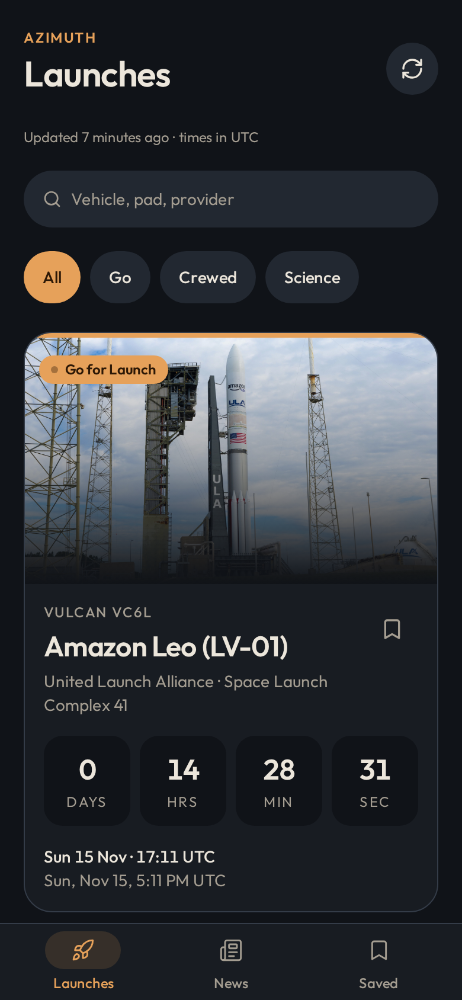
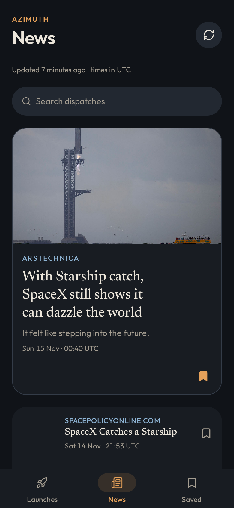
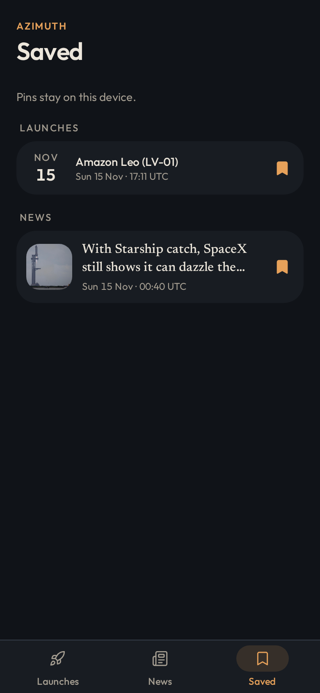

# Azimuth

Upcoming space launches and recent space news.

The next launch has a live countdown in UTC and your local time. Filter by go, crewed, or science, or search by vehicle, pad, or provider. News links out to the original story. Bookmarks stay in this browser.


<p align="center">
  
  
  
</p>

## Run

```bash
npm install
npm run dev
```

The dev server listens on port 8080.

## Data

- Launches from the [Launch Library 2](https://thespacedevs.com/llapi) API
- News from the [Spaceflight News API](https://api.spaceflightnewsapi.net/)

If a feed is unavailable, the app falls back to a briefing packed in the repo.

## License

[MIT](LICENSE)

